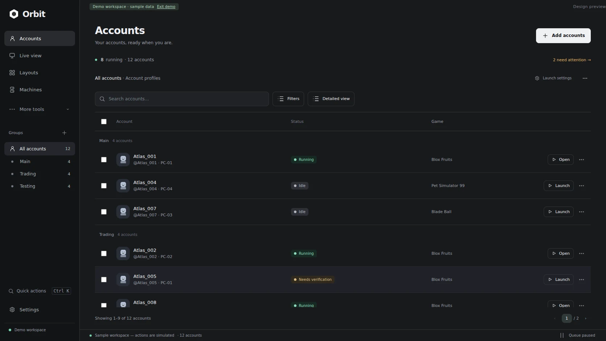

# Orbit

A Windows desktop workspace for Roblox accounts, game windows, and paired PCs.
Built around a quiet graphite interface with mint accents, an account table,
and a session inspector.



## Run it

Requirements: **Windows 10/11**, Node.js **22 or newer**, and an installed Roblox
client or Froststrap. Use Node 24 to match CI.

```sh
npm ci
npm start
```

The app opens with an empty real workspace. **Explore demo** opens isolated
sample data; demo actions never reach the real account vault or launch Roblox.
Exit demo before connecting real accounts.

### Windows download

Every successful [GitHub Actions build](https://github.com/ACABadAngel/Orbit-Roblox-Account-Manager/actions)
uploads an **Orbit-Windows** artifact containing:

- `Orbit-Setup-0.1.1-x64.exe`: installer.
- `Orbit-Portable-0.1.1-x64.exe`: portable application.

Open the latest successful run and download the artifact at the bottom of its
page. These initial builds are unsigned; Windows may show a publisher warning.
You can also build them locally with `npm run dist`.

## Connect and launch

1. Choose **Add accounts**. Sign in in Roblox's own window, then return to Orbit
   and choose **Finish sign-in**. Passwords are not collected by Orbit.
2. In **Settings → Launch profiles**, enter the numeric place ID from a Roblox
   game URL. Optionally specify a server job ID. Assign profiles through the
   account's **Edit** action.
3. Select accounts and choose **Launch**. Orbit obtains a short-lived ticket and
   hands off to the registered `roblox-player` handler. To use a custom installed
   Froststrap launcher, select its `.exe` in Settings.
4. Orbit watches for a single unambiguous new Roblox window. If matching is
   ambiguous, the account remains **Attach window**. Choose **Attach window**
   and verify that the selected game window belongs to that account.

Roblox's authentication and launch endpoints can change. A successful protocol
handoff is not proof of a connected game: **Running** requires a native window.
Existing running windows can be attached manually. Closing a window is detected
as **Disconnected**, rather than silently retried forever.

The app manages many account records; the number of simultaneous Roblox clients
depends on Windows, Roblox, your launcher, the game's rules, and available
hardware. Orbit does not bypass the client's single-instance restrictions or
provide gameplay scripts.

## Remote view and play

1. Install/open Orbit on both computers. On the host, attach the correct Roblox
   windows to its accounts.
2. On the host, enable **Settings → Machine hosting → Enable HTTPS host** and
   select **Local network / VPN**. Enable remote input if desired. Save settings.
3. Choose **Show pairing details**. On the controller, choose **Machines → Pair
   machine**, then enter the address, SHA-256 fingerprint, and pairing token.
   A Windows firewall prompt may require allowing Orbit on your private network.
4. Remote accounts appear in the controller's account list. Open one to watch
   its window or choose **Remote Play → Take control**.

The host certificate is checked against the fingerprint **before** sending the
pairing token. Subsequent connections trust that exact certificate. Host secrets
are encrypted at rest. Token rotation revokes existing controllers.

Remote input is opt-in, limited to an attached `RobloxPlayerBeta` window, and
checks the window's process ID and process start time before input. Only one
account/controller can hold a control lease at once. Losing focus, closing the
player, or a lease timeout releases injected keys and mouse buttons.

**Current remote-play limits:** this version uses PNG window previews at a
configurable 1–10 FPS target, rather than a video codec. Actual rate depends on
capture speed and network latency. Audio, relative/pointer-lock camera input,
and gamepad input are not implemented. Roblox must be restored on the host;
minimized/locked-desktop and some GPU configurations may not capture correctly.
On the same PC, **Take control** brings the actual game window forward for
direct play. Use a private LAN or VPN for machine pairing; no relay, NAT traversal,
or public-host discovery is provided.

## Launch queue and verification

- Configurable spacing (default 15 seconds) and concurrent launch requests
  (default one). These are operational limits, not a promised safe IP threshold.
- CAPTCHA/challenge headers and rate limits pause the queue. `Retry-After`
  is respected, with a minimum one-minute cooldown on rate-limit responses.
- **Stop all** cancels pending and in-flight requests before their next launch
  handoff, and closes attached managed windows on connected hosts.
- Expired sessions and accounts needing verification are skipped until you
  sign in again. Complete Roblox's verification yourself on the host; Orbit
  does not solve or bypass CAPTCHAs.
- No automatic infinite reconnect loop. Use **Reconnect** deliberately after
  reviewing the recorded issue.

## Included workspace tools

- Account search, status/machine filters, groups, multi-selection, pagination,
  account notes, and saved launch profiles.
- Per-host CPU/RAM readings, connection status, and stale/offline host states.
- Account details, live-view grid (up to nine visible previews), screenshots,
  fullscreen preview, and per-session controls.
- One-time local launch/stop schedules. Keep Orbit and the host PC running.
  Schedules more than five minutes late are marked failed rather than replayed.
- Activity history, dark/light themes, and a compact responsive interface.
- Encrypted backup export/import using a separate passphrase. Imports merge
  account/group/profile data; pairing credentials are not exported.

## Local data and protection

Data lives under Electron's user-data directory in `orbit-data/`:

- `workspace.json`: nonsecret account metadata, settings, schedules and history.
- `workspace.json.bak`: last metadata backup.
- `vault.bin`: OS-encrypted Roblox sessions, host key/token, paired-host tokens.

On Windows, Electron safeStorage uses DPAPI. The vault is tied to your Windows
user and is not a replacement for protecting that account. Backup files use
scrypt and AES-256-GCM with independent random salts/nonces. Login windows use
temporary, sandboxed, in-memory sessions. The renderer never receives Roblox
cookies or authentication tickets. Privileged IPC is restricted to the app's
own main frame. The host is off by default.

Do not copy just `vault.bin` to another computer; export a passphrase-protected
Orbit backup instead. Keep backups and their passphrases private.

## Development and checks

```sh
npm run check
npm test
npx playwright install chromium
npm run test:ui
npm run test:desktop   # Windows: actual Electron app, native helper and HTTPS pairing
npm run pack          # Package for the current OS
npm run dist          # Windows: installer + portable app
```

`npm run preview` serves the design at `http://127.0.0.1:4173/#demo`. This browser
preview cannot log into accounts, launch clients, or control game windows.

CI runs core and UI checks on Linux, then native/Electron smoke checks and
installer packaging on Windows. The Linux package is useful for development;
actual Roblox window management targets Windows. Live Roblox authentication,
game launching, capture, and remote input need a real two-PC Windows test with
your own accounts; automated tests do not sign into Roblox.

## Reference projects

Thanks to [Froststrap](https://github.com/Froststrap/Froststrap) for launcher/profile
inspiration and [Roblox Account Manager](https://github.com/ic3w0lf22/Roblox-Account-Manager)
for account organization and launch-flow references. Orbit is an original
implementation and does not bundle either project's code. See
[third-party notices](THIRD_PARTY_NOTICES.md).
